# PRD – Trail Bus Booking Platform

> **Đối tượng đọc:** AI coding agent (Google Antigravity, ChatGPT/GPT hoặc công cụ tương tự) và các thành viên trong nhóm.
> Đây là **nguồn sự thật duy nhất** của dự án. Mục 1–14 là PRD; mục 15 là hướng dẫn khởi tạo dự án. Nếu yêu cầu mới mâu thuẫn với PRD, **dừng lại và hỏi người dùng** trước khi làm.

> **Cập nhật phạm vi 17/10/2026:** mỗi hóa đơn phải có nhân viên đứng tên chịu trách nhiệm; chọn RouteMgr theo phân công chuyến (5.5, 6.2, 7.8). MVP không cung cấp hủy/dời chuyến, hủy/hoàn vé đã mua hoặc module hoàn tiền (4, 5.3, 8). Tách cổng Customer và nội bộ (3.4). Đây là yêu cầu/thiết kế cần triển khai, **chưa phải code hoặc migration đã chạy**. Quyết định này thay thế các quy tắc hủy/hoàn cũ trong PRD và các hướng dẫn agent cũ nếu còn lệch.
>
> **Chốt A03 sau review 21/10/2026:** mục tiêu gồm Customer, Leader, RouteMgr, HRMgr, Admin; Admin phụ trách tài chính. Accountant cũ chuyển thành Customer + Locked, tăng auth_version và audit nguyên tử; không tự nâng thành Admin. Ma trận mục 3 là contract đích; **A02 đã chuyển schema/shared contract và DB development của người dùng sang 5 role**, còn A04 kiểm quyền chi tiết theo module. 

## 0. Hướng dẫn cho AI agent khi làm việc với dự án này

### Quy tắc bắt buộc
- Trả lời bằng tiếng Việt, giữ nguyên tên bảng, cột và thuật ngữ kỹ thuật bằng tiếng Anh.
- Mọi thay đổi schema phải cập nhật mục 6 (ERD) và mục 7 (quy tắc dữ liệu) trong cùng lượt trả lời.
- Không tự thêm tính năng nằm trong mục 2.2 (Out of scope).
- Thao tác tiền và ghế luôn nằm trong DB transaction và phải idempotent.
- Mọi kiểm tra quyền thực hiện ở **server** (middleware + từng route handler), UI chỉ ẩn/hiện cho đẹp.

### Cách làm việc
- Đọc toàn bộ file này trước khi viết bất kỳ dòng code nào.
- Làm từng bước theo mục 14, mỗi lượt một bước, không nhảy cóc.
- Khi PRD không nói rõ hoặc có điểm mâu thuẫn: **không tự đoán**, ghi vào mục 15.7 hoặc hỏi người dùng.
- Cuối mỗi bước, báo cáo: file đã tạo/sửa, lệnh để chạy và kiểm tra, các điểm còn mở.
- Không commit secret. Chỉ commit `.env.example`, không commit `.env`.

## 1. Tổng quan

Hệ thống đặt vé xe kết hợp Leader dẫn đoàn trekking (tham khảo gotrail.vn), phục vụ các tuyến trekking/dã ngoại khứ hồi. Công ty tự sở hữu xe, tài xế, phụ xe và Leader.

Đây là đồ án nhóm, ưu tiên: đúng nghiệp vụ, không bán trùng ghế, không mất dấu tiền, dễ trình bày kiến trúc.

## 2. Phạm vi

### 2.1. In scope
- Tài khoản bắt buộc để mua vé. **Một tài khoản đặt nhiều ghế** trên một chuyến, người mua có thể khác người ngồi (mỗi ghế có thông tin hành khách riêng).
- Một loại vé duy nhất: vé xe khứ hồi kèm Leader dẫn đoàn.
- Chọn ghế cụ thể trên sơ đồ xe; sơ đồ sinh từ xe được điều động cho chuyến.
- Thanh toán bằng **chuyển khoản VietQR, xác nhận tự động qua webhook SePay**.
- Mỗi hóa đơn có một RouteMgr được phân công đứng tên chịu trách nhiệm; khách tự đặt và SePay xác nhận thanh toán, không chờ nhân viên duyệt từng đơn.
- Vé đã mua không cho hủy/hoàn trong MVP. Đơn Pending vẫn hết TTL, nhả đúng ghế đang giữ; mọi giao dịch tiền vào vẫn được ghi nhận/đối soát.
- Quy tắc Leader: số Leader tối thiểu = `CEIL(số vé Valid / N)`, `N` lấy từ `SYSTEM_SETTINGS`.
- Check-in ngày đi bằng quét QR (web mobile), đánh dấu vắng mặt, kết thúc chuyến.
- Nhật ký kiểm toán và báo cáo doanh thu. Đánh giá sau chuyến, chi phí/lãi-lỗ được hoãn theo scope v2; các bảng baseline có thể còn để giữ lịch sử.

### 2.2. Out of scope (P2)
- Khách vãng lai, voucher/mã giảm giá, cộng tác viên, vé phụ (không Leader, Nhập hội), tracklog.
- Thuê xe ngoài, push notification native, đa ngôn ngữ.
- VNPay/MoMo (giả định MVP chỉ dùng chuyển khoản qua SePay).
- Hủy vé đã mua, hoàn vé/hoàn tiền thủ công hoặc tự động, hủy/dời chuyến và chuyển vé sang chuyến khác. Có thể đưa lại ở giai đoạn sau với PRD/kiểm thử riêng.
- Đánh giá sau chuyến và báo cáo chi phí/lãi-lỗ (hoãn theo scope v2).

## 3. Tác nhân (Actors) và phân quyền

### 3.1. Danh sách actor

| Nhóm | Actor | `USERS.role` | Tài khoản | Vai trò chính |
|---|---|---|---|---|
| Người dùng | Khách vãng lai (Guest) | không có | Chưa đăng nhập | Xem tuyến, chuyến, sơ đồ ghế; đăng ký, đăng nhập cổng Customer. Không được giữ ghế hay mua vé |
| Người dùng | Khách hàng | `Customer` | Tự đăng ký | Mua vé, thanh toán, quản lý vé QR; không hủy/hoàn vé đã mua |
| Nhân viên | Leader | `Leader` | HRMgr tạo | Dẫn đoàn ngày đi, quét QR check-in, báo sự cố, kết thúc chuyến |
| Nhân viên | Quản lý Tuyến & Web | `RouteMgr` | Admin tạo | Nội dung tuyến, vận hành chuyến, manifest; đứng tên hóa đơn theo phân công |
| Nhân viên | Quản lý Nhân sự & Đội xe | `HRMgr` | Admin tạo | Xe, bảo dưỡng, hồ sơ nhân sự, phân công; chi phí chuyến deferred |
| Nhân viên | Quản trị viên | `Admin` | Admin tạo | Tài khoản, cấu hình, audit log; superuser |
| Không đăng nhập | Tài xế, Phụ xe | không có (chỉ có `STAFF`) | Không có | Nhận lịch trình in PDF, không dùng hệ thống |
| Hệ thống ngoài | SePay | không có | API Key | Gửi webhook khi có tiền vào |
| Hệ thống ngoài | Scheduler (cron) | không có | `CRON_SECRET` | Chạy tác vụ nền ở mục 9 |

Ghi chú:
- `USERS` là tài khoản đăng nhập, `STAFF` là hồ sơ nhân sự đi tour. Leader có cả hai.
- `Accountant` chỉ còn trong code/schema baseline trước A02, không phải actor đích. A02 chuyển các tài khoản này sang Customer + Locked, tăng auth_version và ghi RoleChanged/AccountStatusChanged trong cùng transaction; giữ user_id và các FK lịch sử. Admin cấp lại quyền phù hợp bằng thao tác riêng sau migration. Tài chính do Admin đối soát; RouteMgr đứng tên hóa đơn không được tự sửa tiền hoặc xác nhận Paid.
- `Admin` là superuser, kế thừa mọi quyền. Mọi thao tác về tiền, đổi trạng thái chuyến và đổi quyền đều ghi `AUDIT_LOGS`.
- Ngân hàng không phải tài khoản đăng nhập; SePay là actor ghi nhận tiền vào. MVP không có tác vụ chi hoàn tiền.

### 3.2. Ma trận quyền theo tài nguyên

Chú thích: **R** xem, **C** tạo, **U** sửa (gồm đổi trạng thái), **D** xóa hoặc khóa, `own` chỉ dữ liệu của chính mình, `asg` chỉ chuyến được phân công, `—` không có quyền. Dữ liệu liên quan chuyến, hóa đơn, tiền không xóa cứng, chỉ đổi trạng thái.

Ma trận đích theo [A03, comment quyết định của Cường ngày 18/10](https://zair0u.atlassian.net/browse/SCRUM-63?focusedCommentId=10005), được review/chấp thuận hướng thiết kế ngày 21/10. Các module chưa có API vẫn là yêu cầu cần triển khai; không suy ra quyền đã được thực thi. Các quyền Customer public được áp dụng cho Guest ở mức chỉ đọc dữ liệu công khai.

| Tài nguyên | Guest | Customer | Leader | RouteMgr | HRMgr | Admin |
|---|:-:|:-:|:-:|:-:|:-:|:-:|
| Tuyến, điểm đón (`TRIPS`, `PICKUP_POINTS`) | R public | R public | R public | CRUD | R | CRUD |
| Chuyến (`DEPARTURES`, `DEPARTURE_PICKUPS`) | R public (Open) | R public (Open) | R asg | C/U Draft, mở/đóng/chốt theo state machine | R | CRU theo state machine |
| Ghế của chuyến (`DEPARTURE_SEATS`) | R public (chỉ trạng thái) | R public, giữ ghế qua đặt vé | R asg phục vụ vận hành | R phục vụ vận hành | R phục vụ phân công | R |
| Xe, sơ đồ ghế xe, bảo dưỡng | — | — | — | — | CRUD | CRUD |
| Hồ sơ nhân sự (`STAFF`) | — | — | R own | Chỉ thông tin phân công, không danh mục nhân sự | CRUD | CRUD |
| Phân công xe, nhân sự (`DEPARTURE_VEHICLES`, `DEPARTURE_STAFF`) | — | — | R asg | R phân công chuyến | CRUD | CRUD |
| Chi phí chuyến (`DEPARTURE_COSTS`) — deferred | — | — | — | — | — | — |
| Hóa đơn, vé (`INVOICES`, `INVOICE_DETAILS`) | — | C, R own | Manifest asg, không hóa đơn/tài chính | R hóa đơn có responsible_user_id của mình | — | R toàn bộ; đổi người phụ trách cho đơn mới |
| Manifest và check-in (`check_in_status`) | — | — | R/U asg | R chuyến mình phụ trách; không sửa check-in theo A03 | — | R/U |
| Thanh toán (`PAYMENTS`) | — | R own qua DTO cần thiết | — | R trạng thái đơn mình phụ trách, không raw payment | — | R/U theo contract NeedsReview; không tùy ý đổi Paid |
| Vật tư: danh mục, tồn, nhập/xuất, cấp theo chuyến (schema/API chưa có) | — | — | R vật tư của chuyến asg | R vật tư của chuyến mình phụ trách | CRUD danh mục; nhập/xuất/cấp/hoàn nhập theo ledger | Như HRMgr |
| Khách hàng và lịch sử đặt vé | — | R/U own | PII cần thiết trong manifest asg | Hành khách thuộc hóa đơn mình phụ trách | — | R toàn bộ |
| Hoàn tiền/chính sách hoàn/đánh giá — deferred | — | — | — | — | — | — |
| Tài khoản (`USERS`) | C (đăng ký Customer) | U own | U own | U own | C (chỉ tài khoản Leader), U own | CRU, D = khóa |
| Cấu hình (`SYSTEM_SETTINGS`) | — | — | — | — | — | R/U |
| Nhật ký (`AUDIT_LOGS`) | — | — | — | — | — | R |
| Báo cáo vận hành (không doanh thu, PII hoặc ngân hàng ngoài phạm vi role) | — | — | — | R trong phạm vi vận hành | R trong phạm vi nguồn lực | R |
| Báo cáo doanh thu; lãi/lỗ deferred | — | — | — | — | — | R |

Quyền tự quản lý hồ sơ và HRMgr cấp tài khoản Leader kèm STAFF tiếp tục theo mục 3.3/O02; ô tài khoản Admin trong A03 không xóa các quyền chuyên biệt này. So với ma trận trước A03: RouteMgr không đọc danh mục xe/bảo dưỡng hoặc sửa check-in; HRMgr không đọc hóa đơn hoặc cấu hình hệ thống. Quyền xem thông tin vận hành tối thiểu không mở toàn bộ tài nguyên hay dữ liệu cá nhân. Admin kế thừa quyền role nhưng vẫn chịu validation, state machine, tính bất biến và giới hạn MVP.

Hành động đặc biệt:
- Chốt chạy: `RouteMgr`, `Admin`. Hủy/dời chuyến nằm ngoài MVP; mọi role, kể cả Admin, không được đi qua cạnh Cancelled/Rescheduled trong workflow mới (8.4).
- Kết thúc chuyến: `Leader` (chuyến mình được phân công), `Admin`.
- Webhook thanh toán: chỉ actor SePay, chỉ gọi được `POST /api/webhooks/sepay`.
- Tác vụ nền: chỉ actor Scheduler, chỉ gọi được `/api/cron/*`.

### 3.3. Quy tắc phân quyền ở tầng dữ liệu

- Customer chỉ truy cập hóa đơn/vé của chính mình (`INVOICES.customer_id = user đang đăng nhập`). RouteMgr đọc hóa đơn có `responsible_user_id` của mình; API manifest vận hành là phạm vi khác, không tự mở quyền tiền. Admin xem toàn bộ.
- Leader chỉ truy cập chuyến có mình trong `DEPARTURE_STAFF` (qua `STAFF.user_id`) và chỉ khi chuyến ở trạng thái `Confirmed`, `Running` hoặc `Ended`. Leader thấy số điện thoại tài xế, phụ xe cùng chuyến, không thấy `PAYMENTS`, `REFUNDS` hay thông tin ngân hàng.
- Thông tin cá nhân hành khách chỉ trả đúng DTO cần thiết: Leader trong manifest asg; RouteMgr với hóa đơn mình phụ trách hoặc manifest chuyến mình phụ trách; Admin và chủ hóa đơn. Không cấp quyền CRM toàn bộ cho RouteMgr hoặc Leader.
- Thông tin ngân hàng nhận hoàn tiền (`REFUNDS.bank_*`) nếu có trong dữ liệu legacy phải tiếp tục được bảo vệ; không mở API/UI thu thập hoặc đọc mới vì module refund deferred. Không đưa vào log.
- Tách nhiệm vụ: Customer là người mua; RouteMgr là người đứng tên chịu trách nhiệm hóa đơn; SePay là nguồn xác nhận tiền; Admin xử lý NeedsReview theo contract được duyệt. Không đồng nhất bốn vai trò này. Không phát sinh REFUNDS trong MVP.
- Tạo tài khoản: Customer tự đăng ký (`role = Customer`); HRMgr tạo tài khoản Leader kèm hồ sơ `STAFF`; Admin quản trị tài khoản trong năm role đích, không tạo Accountant mới sau cutover A02/A04. Không có luồng tự nâng quyền.
- Cách thực thi: middleware kiểm role theo nhóm route (`/admin`, `/staff`, `/leader`, `/account`), service kiểm quyền theo hàng dữ liệu trước khi truy vấn. Không tin quyền do client gửi lên.

### 3.4. Hai cổng đăng nhập, một nền tảng Auth

| Cổng | Tài khoản được đăng nhập mới | Đích mặc định sau đăng nhập |
| --- | --- | --- |
| Public: `/login`, `/register` từ trang chủ | Chỉ Customer; đăng ký luôn Customer | `/account`, hoặc callback Customer hợp lệ như checkout |
| Nội bộ: `/staff/login` | RouteMgr, HRMgr, Leader, Admin sau cutover A02/A04; Accountant legacy phải bị khóa/thu hồi phiên | RouteMgr/HRMgr → `/staff`; Leader → `/leader`; Admin → `/admin` |

- Cổng nội bộ dùng shell vận hành, không có đăng ký công khai hay chọn role để nâng quyền. Không cần tạo bốn trang login riêng hoặc bốn backend Auth. UI portal sau login vẫn đặc thù theo role; Anti triển khai sau contract backend.
- Dùng chung USERS, Auth.js, kiểm password, CSRF, JWT, auth_version và limiter. Server kiểm role/status thực tế theo cổng trước khi cấp session; không chỉ ẩn liên kết hoặc redirect sau khi đã cấp phiên sai cổng. Không tin role, portal hoặc callback do client gửi để cấp quyền.
- Customer dùng credentials ở cổng nội bộ hoặc nhân viên dùng cổng Customer: từ chối bằng thông báo chung, không tiết lộ email thuộc role nào. Callback chỉ cùng origin và thuộc nhóm route được role truy cập; cấm URL ngoài site, protocol-relative và đích sai quyền.
- Người chưa đăng nhập mở /staff, /leader, /admin phải tới /staff/login; mở /account hoặc checkout tới /login. /staff/login phải được loại khỏi guard đòi session để không redirect vòng lặp. API vẫn trả 401/403 có cấu trúc, không redirect HTML.
- Người đã có session hợp lệ mở một trang login thì về portal của role hiện tại; không tự đổi tài khoản/role. Hai cổng trên cùng origin dùng chung một phiên: muốn đổi tài khoản phải logout. Session Customer không vào portal nội bộ; mọi protected handler/service vẫn kiểm DB/RBAC.
- Limiter theo tài khoản/IP phải chia sẻ ngân sách giữa hai cổng, tránh tăng gấp đôi số lần đoán mật khẩu. Khóa tài khoản, auth_version, absolute expiry, CSRF và logout phải giữ đúng ở cả hai cổng.
- Checkpoint 21/10: backend/UI hai cổng có từ PR #12; A02 đã merge PR #14 và chuyển schema/shared contract sang 5 role. A04 nghiệm thu quyền trên 23 protected API methods của baseline; HTTP matrix/CI và bản sửa teardown đã merge trong [PR #15](https://github.com/quynhtien1977/go-trail/pull/15), develop `bfc4131`. Quality GitHub xanh ở head `31ad67a` và merge commit; local 100 tests + 535 HTTP checks PASS. C01 tiếp tục nghiệm thu/sửa UI qua [handoff Anti](handoffs/c01-ui-fixes-after-a04.md). Quyền module chưa merged tiếp tục theo dependency A03; không suy ra toàn bộ module đã hoàn thành. Xem [biên bản A04](reviews/a04-rbac-acceptance-2026-10-21.md).

## 4. Máy trạng thái (MVP cập nhật 17/10/2026)

**DEPARTURES.status**
```text
Draft → Open → Closed → Confirmed → Running → Ended
```
- Draft → Open: đã gán ít nhất 1 xe/sinh ghế và có RouteMgr Active chịu trách nhiệm hóa đơn (5.5). Đây là điều kiện bổ sung mới.
- Open → Closed: quá booking_deadline hoặc hết ghế. Closed → Confirmed: đủ min_passengers, mỗi xe ≥ 1 Driver + ≥ 1 Assistant, đủ Leader theo tỷ lệ 1:N.
- Không cung cấp Cancelled/Rescheduled, đổi chuyến/đổi lịch của vé đã bán trong MVP, kể cả với Admin. Enum cũ có thể còn trong DB để giữ lịch sử; enum tồn tại không có nghĩa API được phép chuyển tới. Không sửa lịch khởi hành đã mở bán để lách luồng dời chuyến.

**INVOICES.status:** Pending → Paid hoặc Expired. Paid không chuyển Cancelled/Expired. Expired chỉ có thể được xác nhận Paid theo contract tiền đến trễ 5.2.1; không do người dùng tự phục hồi.

**INVOICE_DETAILS.status:** Pending → Valid khi nhận tiền hợp lệ; Pending → Cancelled khi hold hết hạn (dọn kỹ thuật). Valid không chuyển Cancelled trong MVP. Check-in Pending/CheckedIn/Absent không đổi quyền sở hữu vé/ghế.

**DEPARTURE_SEATS.status:** Available ⇄ Locked → Sold. Chỉ hold chưa trả tiền hết hạn được nhả; Sold không trở lại Available trong MVP.

**REFUNDS.status:** mô hình legacy/deferred, không có workflow tạo/duyệt/chi hoàn trong MVP. Giữ bảng/dữ liệu và migrations cũ.

**PAYMENTS.status:** Success | NeedsReview. Bỏ hoàn vé không đồng nghĩa bỏ ghi nhận tiền bất thường.

## 5. Luồng nghiệp vụ chính

### 5.1. Đặt vé và giữ ghế
1. Customer chọn chuyến (status `Open`, chưa quá `booking_deadline`), chọn tối đa `MAX_SEATS_PER_INVOICE` ghế, nhập thông tin từng hành khách (tên, SĐT, liên hệ khẩn cấp, cam kết sức khỏe) và điểm đón.
2. Server kiểm RouteMgr phụ trách chuyến đang Active và lấy snapshot trong transaction theo 7.8; không nhận nhân viên do Customer chọn. Server mở **một transaction**: tạo `INVOICES` trước (`Pending`, `expires_at = now + SEAT_TTL_MINUTES`, `payment_code` duy nhất), rồi khóa từng ghế theo thứ tự `dep_seat_id` tăng dần bằng câu UPDATE nguyên tử (mục 7.1). Ghế nào `Rows Affected = 0` thì rollback toàn bộ, kể cả hóa đơn, và báo ghế đã có người chọn.
3. Tạo các `INVOICE_DETAILS` (`Pending`) trong cùng transaction sau khi khóa đủ ghế.
4. Trả về trang thanh toán: mã VietQR với **số tiền = `total_amount`** và **nội dung chuyển khoản = `payment_code`**, kèm đồng hồ đếm ngược.

### 5.2. Xác nhận thanh toán (webhook SePay)
`POST /api/webhooks/sepay`, xử lý theo thứ tự:
1. Xác thực header `Authorization: Apikey <secret>` (hoặc chữ ký HMAC nếu cấu hình). Sai thì trả 401.
2. Chỉ xử lý `transferType = "in"`. Tìm hóa đơn theo trường `code` (= `payment_code`).
3. Chống trùng: chèn `PAYMENTS` với `transaction_id` = `id` của SePay (UNIQUE). Nếu trùng, trả `{"success": true}` ngay, không làm gì thêm. SePay tự retry tối đa 7 lần trong khoảng 33 phút nếu endpoint lỗi, nên bước này bắt buộc.
4. Trong một transaction, nếu hóa đơn còn hợp lệ (xem 5.2.1) và `transferAmount >= total_amount`: hóa đơn `Paid`, ghế `Sold` (`locked_until = NULL`), vé `Valid` kèm `ticket_code` (QR), payment `Success`.
5. Mọi trường hợp còn lại: payment `NeedsReview`, **không đổi trạng thái ghế/hóa đơn**, Admin đối soát theo contract P03/B04; không tự phát hành vé, đổi Sold hoặc tạo refund khi chưa có điều kiện xác nhận hợp lệ. Giao dịch chưa giải quyết vẫn NeedsReview và được hiển thị để xử lý.
6. Luôn trả HTTP 200 với body `{"success": true}` sau khi đã ghi nhận, kể cả `NeedsReview`.

**5.2.1. Hóa đơn còn hợp lệ** nghĩa là: status `Pending`, hoặc `Expired` nhưng mọi ghế của nó vẫn `Available` hoặc `Locked` bởi chính hóa đơn này (chưa ai lấy). Trường hợp sau được **khóa lại và xác nhận** (thanh toán đến trễ nhưng ghế chưa mất). Nếu có ghế đã bị người khác lấy thì `NeedsReview`.

Các tình huống `NeedsReview`: chuyển thiếu/thừa theo quyết định B04, sai nội dung (không tìm thấy hóa đơn), ghế đã bị lấy hoặc chuyến không còn hợp lệ (kể cả dữ liệu Cancelled legacy). **B04 vẫn mở:** mâu thuẫn `>=` ở bước 4 với thừa tiền ở NeedsReview phải được chốt trước triển khai payment; quyết định không hủy/hoàn vé không phải quyết định giữ tiền chuyển thừa.

### 5.3. Không hủy/hoàn vé trong MVP

- Vé Valid/hóa đơn Paid không được Customer, RouteMgr hay Admin hủy/hoàn/chuyển chuyến. Không có nút/API hủy, không thu thập tài khoản nhận hoàn tiền.
- Hiển thị chính sách rõ trước khi tạo đơn và trước thanh toán: đã mua không hủy/hoàn trong phạm vi MVP.
- Pending hết expires_at vẫn Expired; chỉ dọn vé Pending và ghế còn do invoice đó giữ. Đóng trình duyệt/thoát checkout không phải hủy vé đã mua. Cron không được ghi đè Sold/hold của hóa đơn mới.
- Chặn các thao tác hủy/hoàn nếu được gửi trực tiếp tới server; không chỉ giấu UI. Route không triển khai trả 404; command trạng thái không hỗ trợ trả lỗi nghiệp vụ ổn định, dữ liệu không đổi.
- Chuyển tiền sai/thiếu/thừa/trễ vẫn được ghi nhận NeedsReview theo 5.2/8.2; không đánh Success hoặc coi như hoàn tiền chỉ để đóng việc.

### 5.4. Check-in ngày đi
Leader mở web mobile, quét QR (`ticket_code`). Hệ thống kiểm tra vé `Valid`, đúng chuyến và Leader được phân công cho chuyến đó, rồi đặt `check_in_status = CheckedIn`, ghi `check_in_time`. Vé hủy hoặc sai chuyến báo lỗi rõ ràng. Leader có thể đánh dấu `Absent`. Khi Leader kết thúc chuyến, chuyến thành `Ended`; đánh giá sau chuyến được hoãn, không thay đổi Paid/Valid/Sold.

### 5.5. Nhân viên đứng tên chịu trách nhiệm hóa đơn

- **Chọn RouteMgr**, vì người này vận hành chuyến và xử lý thông tin khách/vé. Leader chỉ dẫn đoàn/check-in; HRMgr lo xe/nhân sự; Admin giám sát và đối soát tiền. Không cần thêm role Nhân viên bán vé trong MVP.
- Mỗi Departure chọn một RouteMgr Active làm người phụ trách hóa đơn. Khi RouteMgr tạo Draft, mặc định chính họ; Admin tạo Draft thì phải chọn RouteMgr trước khi mở bán. Không dùng tài khoản chung/nhân viên giả hoặc chọn ngẫu nhiên khi thiếu phân công.
- Khi tạo Invoice Pending, server tự sao chép user_id, full_name và role của người phụ trách vào invoice trong cùng transaction giữ ghế. Customer chỉ là người mua, không được gửi/đổi các trường trách nhiệm. Hiển thị nhãn **Nhân viên phụ trách hóa đơn**; không ghi người đó đã kiểm/duyệt tiền nếu không thực sự có hành động đó.
- Hóa đơn có mã, người mua, chuyến, ghế/hành khách, số tiền/trạng thái, ngày lập và tên nhân viên phụ trách. UI/print dùng snapshot; không chỉ render tên từ tài khoản đang đăng nhập hoặc tên hiện tại qua JOIN.
- Admin được đổi phân công của Departure, có audit; chỉ áp dụng cho invoice mới. Invoice đã tạo, kể cả Pending/Paid, giữ user_id và snapshot ban đầu. Admin xử lý tiếp khi nhân viên nghỉ/khóa tài khoản; không sửa tên lịch sử trên hóa đơn. Người khác xử lý giao dịch được lưu qua audit actor riêng.
- Việc nhân viên bị khóa/đổi tên/role sau khi lập invoice không xóa trách nhiệm hoặc làm hỏng thanh toán của đơn hợp lệ. Chặn đơn mới nếu người phụ trách hiện tại không còn Active RouteMgr; Admin phân công lại.
- Đây là hóa đơn/phiếu mua vé của đồ án; yêu cầu này không tự bổ sung module hóa đơn điện tử thuế, chữ ký số hoặc ký duyệt thủ công từng đơn.

## 6. Mô hình dữ liệu (ERD)

ERD giữ các bảng/trạng thái baseline, kể cả refund/review deferred. `DEPARTURES.invoice_owner_user_id` đã có migration trong nhánh tích hợp O03/O04 ngày 26/10; các cột snapshot trách nhiệm trên INVOICES có nhãn PLANNED vẫn là thiết kế đích, chưa triển khai trong nhánh này. Xem 6.2 và 7.8; có migration trong repo không đồng nghĩa đã áp dụng vào DB của từng thành viên.

`USERS.role` bên dưới có năm giá trị theo A02 đã merge. Migration chuyển dữ liệu Accountant cũ trước khi thay kiểu enum; không xóa tài khoản hoặc FK. Đã kiểm thử local và áp dụng/xác minh trên Supabase development của người dùng ngày 21/10; không suy ra đã áp dụng trên DB riêng của thành viên khác.

```mermaid
erDiagram
    USERS {
        int user_id PK
        varchar email UK
        varchar password_hash
        nvarchar full_name
        varchar phone
        varchar role "Customer, Leader, RouteMgr, HRMgr, Admin"
        varchar status "Active, Locked"
        int auth_version "Default 0; revoke previous JWTs after access changes"
        datetime created_at
    }

    SYSTEM_SETTINGS {
        varchar setting_key PK "LEADER_RATIO, SEAT_TTL_MINUTES, MAX_SEATS_PER_INVOICE"
        nvarchar setting_value
        nvarchar description
    }

    AUDIT_LOGS {
        int log_id PK
        int user_id FK
        varchar action
        varchar table_name
        varchar record_id
        nvarchar description
        datetime created_at
    }

    STAFF {
        int staff_id PK
        int user_id FK "Nullable, only Leader has an account"
        nvarchar full_name
        varchar phone
        varchar staff_type "Driver, Assistant, Leader"
        varchar license_number
        varchar license_class
        date license_expiry
        varchar status "Active, Inactive"
    }

    VEHICLES {
        int vehicle_id PK
        varchar plate_number UK
        nvarchar vehicle_type
        int seat_count
        varchar status "Ready, Maintenance, Inactive"
    }

    VEHICLE_SEATS {
        int seat_id PK
        int vehicle_id FK
        varchar seat_name
        int floor_level
        int x_position
        int y_position
        bit is_active
    }

    VEHICLE_MAINTENANCE {
        int maintenance_id PK
        int vehicle_id FK
        date start_date
        date end_date
        nvarchar description
        decimal cost
    }

    TRIPS {
        int trip_id PK
        nvarchar name
        nvarchar city "Province or city"
        nvarchar district "District or area, nullable"
        nvarchar location_name "Specific place, e.g. Nui Ba Den"
        nvarchar difficulty_level "Nullable = unknown"
        decimal length_km
        int peak_height_m "Nullable = unknown or not applicable"
        decimal base_price
        nvarchar description
        nvarchar schedule_content
        nvarchar source_url "Nullable, unique source identity"
        datetime source_fetched_at "Nullable, UTC snapshot timestamp"
        boolean is_active "Default true; retired trips retain history"
    }

    TRIP_MEDIA {
        int media_id PK
        int trip_id FK
        enum placement "Cover, Hero, Highlight, Schedule"
        int sort_order "0..99; Cover = 0"
        nvarchar source_url "Original image URL, internal provenance"
        nvarchar storage_url "Public immutable Storage object URL"
        char content_sha256 "64 lowercase hex"
        nvarchar alt_text
        nvarchar caption "Nullable; no invented capture time/place"
        nvarchar title "Highlight title; null for other placements"
        nvarchar body "Nullable highlight description"
        boolean is_active
        datetime created_at "UTC"
    }

    PICKUP_POINTS {
        int pickup_id PK
        int trip_id FK
        nvarchar name
        nvarchar address
        boolean is_active "Default true; retired points retain history"
    }

    DEPARTURES {
        int departure_id PK
        int trip_id FK
        datetime departure_date
        int min_passengers
        datetime booking_deadline
        decimal price_override "Null = use base_price"
        varchar status "Draft, Open, Closed, Confirmed, Running, Ended, Cancelled, Rescheduled"
        boolean is_demo "Default false; development fixture only"
        int invoice_owner_user_id FK "Nullable legacy; Active RouteMgr before Open"
    }

    DEPARTURE_PICKUPS {
        int dep_pickup_id PK
        int departure_id FK
        int pickup_id FK
        datetime pickup_time
    }

    DEPARTURE_VEHICLES {
        int dep_vehicle_id PK
        int departure_id FK
        int vehicle_id FK
    }

    DEPARTURE_SEATS {
        int dep_seat_id PK
        int dep_vehicle_id FK
        int seat_id FK
        varchar status "Available, Locked, Sold"
        datetime locked_until "Null unless Locked"
        int invoice_id FK "Null if Available"
    }

    DEPARTURE_STAFF {
        int dep_staff_id PK
        int departure_id FK
        int staff_id FK
        varchar role_in_trip "Driver, Assistant, Leader"
        int dep_vehicle_id FK
    }

    DEPARTURE_COSTS {
        int cost_id PK
        int departure_id FK
        varchar cost_type "Fuel, Toll, Staff, Other"
        decimal amount
        nvarchar description
    }

    INVOICES {
        int invoice_id PK
        int customer_id FK "Buyer"
        int responsible_user_id FK "PLANNED; copied from departure owner"
        nvarchar responsible_name_snapshot "PLANNED; name at invoice creation"
        varchar responsible_role_snapshot "PLANNED; RouteMgr at creation"
        int departure_id FK
        varchar payment_code UK "Transfer content, e.g. TB000123"
        decimal total_amount
        varchar status "Pending, Paid, Expired, Cancelled"
        datetime expires_at
        datetime created_at
    }

    INVOICE_DETAILS {
        int detail_id PK
        int invoice_id FK
        int dep_seat_id FK "Unique only when status != Cancelled"
        int dep_pickup_id FK
        int refund_id FK "Null unless cancelled with refund"
        nvarchar passenger_name
        varchar passenger_phone
        nvarchar emergency_contact
        bit health_declaration
        decimal unit_price
        varchar ticket_code UK "QR payload, set when Valid"
        varchar status "Pending, Valid, Cancelled"
        varchar check_in_status "Pending, CheckedIn, Absent"
        datetime check_in_time
    }

    PAYMENTS {
        int payment_id PK
        int invoice_id FK "Nullable, null if code not matched"
        decimal amount
        varchar payment_method "BankTransfer"
        varchar transaction_id UK "SePay transaction id"
        varchar reference_code
        varchar status "Success, NeedsReview"
        nvarchar raw_payload "Webhook JSON for audit"
        datetime created_at
    }

    REFUND_POLICY_RULES {
        int rule_id PK
        int hours_before_departure
        int refund_percentage
    }

    REFUNDS {
        int refund_id PK
        int invoice_id FK
        int payment_id FK "Payment being refunded"
        decimal amount
        varchar refund_type "CustomerCancel, TripCancelled, PaymentIssue"
        varchar method "Manual, SePayApi"
        varchar status "Pending, Approved, Rejected, Completed, Failed"
        nvarchar reason
        nvarchar bank_name
        varchar bank_account_number
        nvarchar bank_account_holder
        varchar idempotency_key UK "refund-invoice_code-seq"
        varchar provider_refund_id "SePay RF-..., null if Manual"
        varchar payout_reference "Bank ref entered by Accountant or Admin"
        int requested_by FK
        int approved_by FK
        datetime created_at
        datetime completed_at
    }

    REVIEWS {
        int review_id PK
        int detail_id FK, UK
        int customer_id FK
        int rating "1 - 5"
        nvarchar comment
        datetime created_at
    }

    USERS ||--o{ INVOICES : "buys"
    USERS ||--o{ INVOICES : "responsible employee PLANNED"
    USERS |o--o{ DEPARTURES : "invoice owner"
    USERS |o--o| STAFF : "Leader account"
    USERS ||--o{ AUDIT_LOGS : "triggers"
    USERS ||--o{ REVIEWS : "writes"
    USERS ||--o{ REFUNDS : "requests or approves"

    TRIPS ||--o{ DEPARTURES : "has"
    TRIPS ||--o{ PICKUP_POINTS : "has"
    TRIPS ||--o{ TRIP_MEDIA : "has"

    DEPARTURES ||--o{ DEPARTURE_PICKUPS : "schedules"
    DEPARTURES ||--o{ DEPARTURE_VEHICLES : "uses"
    DEPARTURES ||--o{ DEPARTURE_STAFF : "assigns"
    DEPARTURES ||--o{ DEPARTURE_COSTS : "incurs"
    DEPARTURES ||--o{ INVOICES : "sold via"

    PICKUP_POINTS ||--o{ DEPARTURE_PICKUPS : "used at"

    VEHICLES ||--o{ VEHICLE_SEATS : "layout"
    VEHICLES ||--o{ VEHICLE_MAINTENANCE : "undergoes"
    VEHICLES ||--o{ DEPARTURE_VEHICLES : "deployed"

    DEPARTURE_VEHICLES ||--o{ DEPARTURE_SEATS : "generates"
    DEPARTURE_VEHICLES ||--o{ DEPARTURE_STAFF : "crew"
    VEHICLE_SEATS ||--o{ DEPARTURE_SEATS : "maps"
    STAFF ||--o{ DEPARTURE_STAFF : "works"

    INVOICES ||--|{ INVOICE_DETAILS : "contains"
    INVOICES |o--o{ PAYMENTS : "paid by"
    INVOICES ||--o{ REFUNDS : "refunded by"
    INVOICES |o--o{ DEPARTURE_SEATS : "locks"
    PAYMENTS ||--o{ REFUNDS : "refunds"
    REFUNDS |o--o{ INVOICE_DETAILS : "covers"
    DEPARTURE_SEATS ||--o{ INVOICE_DETAILS : "ticket history, at most one active"
    DEPARTURE_PICKUPS ||--o{ INVOICE_DETAILS : "boards at"
    INVOICE_DETAILS ||--o| REVIEWS : "reviewed"
```



### 6.1. Ánh xạ PostgreSQL của schema khởi tạo

- Baseline hiện có 22 bảng nghiệp vụ sau khi thêm TripMedia (21 bảng ở mốc Auth trước đó), tên bảng lowercase snake_case và giữ tên cột trong ERD. PK số dùng autoincrement; trạng thái dùng enum. Tiền `numeric(14,0)`, quãng đường `numeric(8,2)`; datetime dùng `timestamptz(6)`, giấy phép/bảo dưỡng dùng `date`.
- `STAFF.user_id` nullable và unique (Leader 1:1); các cột giấy phép nullable vì Assistant/Leader không cần giấy phép tài xế. Chỉ Leader được gắn tài khoản.
- `INVOICE_DETAILS.ticket_code`, `check_in_time` nullable trước khi phát vé/check-in. `REFUNDS.approved_by`, `completed_at`, `provider_refund_id`, `payout_reference` nullable trước khi xử lý.
- `REFUNDS.requested_by` và các trường `bank_*` nullable theo thiết kế legacy; giữ nguyên schema, không có luồng hủy/dời tự tạo refund trong MVP mới.
- Các nullable khác theo ERD: `district`, `price_override`, `locked_until`, khóa hóa đơn của ghế, khóa payment không khớp mã và khóa refund của vé. Các FK dùng `ON DELETE RESTRICT` để giữ lịch sử; không cascade xóa tài chính.
- Prisma migrations là lịch sử schema duy nhất. Bật RLS và thu hồi quyền table/sequence của `PUBLIC`, `anon`, `authenticated`, `service_role` trên bảng nghiệp vụ. Truy cập qua Prisma backend; quyền ứng dụng theo Auth.js/service, chưa mở Data API policies.
- Catalog tham khảo từ GoTrail: `TRIPS.difficulty_level` và `peak_height_m` nullable khi chưa xác minh/không áp dụng; không dùng 0 hoặc độ cao tích lũy thay độ cao đỉnh. `source_url` nullable + unique nhận diện tuyến import, `source_fetched_at` lưu thời điểm snapshot UTC. `PICKUP_POINTS.is_active=false` giữ điểm cũ để bảo toàn FK; `DEPARTURES.is_demo=true` phân biệt chuyến kiểm thử với lịch vận hành.
- Quyết định catalog ngày 14/10/2026 đã được người dùng duyệt: `TRIPS.is_active` Boolean default true, khóa tuyến bằng false thay xóa cứng. Migration giữ tất cả tuyến cũ active; không xóa hoặc thay đổi chuyến/vé đã có.
- Media theo lựa chọn A ngày 15/10/2026: `TripMedia` thuộc một tuyến, unique `(trip_id, placement, sort_order)`; Cover chỉ có order 0. File nằm Supabase Storage, bảng chỉ lưu metadata; cùng file có thể dùng nhiều placement. FK RESTRICT, RLS và thu hồi quyền Data API như các business tables hiện có. Không thêm binary tuyến vào src/public/data.
- Bước Auth chỉ thêm `USERS.auth_version` số nguyên không âm, default 0, dùng thu hồi JWT cũ sau đổi role hoặc khóa/mở khóa. Rate counters lưu trong Upstash Redis với TTL, không có bảng `AUTH_RATE_LIMITS`. Không thêm bảng Auth.js account/session vì dùng credentials + JWT.
- A02 thêm migration `20261021000000_five_roles`: Accountant → Customer + Locked, tăng auth_version và audit trong cùng transaction; thay enum UserRole bằng năm giá trị. Giữ default Customer, RLS/grants, user_id và mọi FK/lịch sử; không gộp migration trách nhiệm hóa đơn của O03/K02. Seed mới tạo năm role, không tái tạo/mở khóa Accountant cũ.

### 6.2. Migration người chịu trách nhiệm: O03 đã tích hợp, snapshot invoice còn kế hoạch

- DEPARTURES.invoice_owner_user_id → USERS.user_id, nullable cho Draft/legacy; service bắt buộc Active RouteMgr khi mở bán và tạo đơn. Chỉ Admin đổi người đã phân công; RouteMgr tự nhận lúc tạo Draft.
- INVOICES.responsible_user_id → USERS.user_id, responsible_name_snapshot và responsible_role_snapshot; bắt buộc với invoice mới sau cutover. Tham chiếu USERS vì STAFF chỉ mô hình Driver/Assistant/Leader, không ép RouteMgr thành nhân sự đi tour.
- FK RESTRICT, index cho FK và danh sách invoice theo nhân viên/ngày. Tạo hai relation User→Invoice rõ tên: buyer và responsible employee. Snapshot không thay FK, FK không thay snapshot.
- Migration theo expand/backfill/enforce: đọc số liệu DB đích trước; nếu có invoice cũ chưa biết nhân viên thì lập danh sách ngoại lệ cho Admin xác minh, không gán bừa người tạo seed/đang đăng nhập. Chỉ siết NOT NULL toàn bảng khi dữ liệu đủ; record legacy chưa xác minh hiển thị rõ thay vì tạo tên giả.
- Không xóa tài khoản Accountant cũ, Refund/Cancelled hoặc sửa migration đã áp dụng trong thay đổi trách nhiệm hóa đơn. Loại giá trị Accountant khỏi UserRole và chuyển tài khoản thuộc migration A02 riêng; bỏ tính năng không đồng nghĩa xóa dữ liệu.
- Checkpoint 26/10: nhánh tích hợp O03/O04 có migration `20261018000000_departure_invoice_owner` từ PR #7: thêm FK nullable RESTRICT và index; giữ nguyên NULL của legacy, không gán nhân viên giả. Kiểm thử cả DB trống và bổ sung migration này sau baseline A02 năm role. Chưa áp dụng Supabase trong đợt tích hợp. Các cột/snapshot INVOICES và backfill thuộc K02, chưa có trong nhánh này.

## 7. Quy tắc dữ liệu và đồng thời

### 7.1. Khóa ghế nguyên tử
```sql
-- PostgreSQL
UPDATE departure_seats
SET status = 'Locked',
    locked_until = now() + make_interval(mins => $ttl),
    invoice_id = $invoice_id
WHERE dep_seat_id = $seat_id
  AND (status = 'Available' OR (status = 'Locked' AND locked_until < now()));
```
- **Không** dùng điều kiện `OR locked_until < now()` đơn lẻ, vì ghế `Sold` còn `locked_until` cũ sẽ bị khớp và bán trùng.
- Khi chuyển `Sold` hoặc `Available`, luôn đặt `locked_until = NULL`.
- Khóa nhiều ghế: một transaction, theo thứ tự `dep_seat_id` tăng dần để tránh deadlock.
- Truy vấn sơ đồ ghế coi ghế `Locked` đã quá `locked_until` là `Available` (không phụ thuộc cron).
- Khi giữ lại ghế từ một hold hết hạn, transaction booking phải hủy vé `Pending` cũ và xử lý hóa đơn hết hạn trước khi chèn vé mới, để partial unique không phụ thuộc cron dọn trước. Không hủy vé `Valid` hoặc ghi đè ghế `Sold`.

### 7.2. Ràng buộc nên có
- UNIQUE(`dep_vehicle_id`, `seat_id`) ở `DEPARTURE_SEATS`.
- Partial UNIQUE(`dep_seat_id`) ở `INVOICE_DETAILS` khi `status <> 'Cancelled'`; giữ lịch sử ticket Pending đã hết hạn và cho phép ghế được đặt lại. Không áp dụng hủy vé Valid trong MVP. UNIQUE(`transaction_id`) ở `PAYMENTS`; UNIQUE(`payment_code`) ở `INVOICES`; UNIQUE(`idempotency_key`) ở `REFUNDS` legacy.
- UNIQUE(`departure_id`, `staff_id`, `role_in_trip`) ở `DEPARTURE_STAFF`.
- Không điều xe vào chuyến nếu khoảng ngày chuyến giao với `VEHICLE_MAINTENANCE`; không phân công tài xế có `license_expiry` trước ngày chuyến.
- Mọi tiền dùng `decimal` (VND, số nguyên), không dùng float.
- UNIQUE(`vehicle_id`, `seat_name`), UNIQUE(`departure_id`, `vehicle_id`), UNIQUE(`departure_id`, `pickup_id`); ngưỡng `REFUND_POLICY_RULES.hours_before_departure` unique để không mơ hồ khi chọn chính sách.
- CHECK: tiền không âm (refund phải > 0), rating 1–5, tỷ lệ hoàn 0–100, số giờ chính sách không âm, sức chứa/min_passengers > 0, tọa độ ghế không âm/tầng >= 1, ngày kết thúc bảo dưỡng >= ngày bắt đầu, deadline <= ngày khởi hành.
- CHECK trạng thái ghế: `Available` không có invoice/expiry; `Locked` có cả invoice và expiry; `Sold` có invoice, expiry NULL. Mỗi FK có index phục vụ truy vấn và kiểm tra tham chiếu.
- Service bắt buộc kiểm tra quan hệ chéo trong transaction: ghế thuộc đúng xe; điểm đón thuộc đúng tuyến; phân công xe thuộc đúng chuyến và role đúng loại nhân sự; invoice detail/ghế/điểm đón cùng chuyến; payment được refund thuộc đúng invoice; review thuộc vé của customer. FK đơn lẻ chưa kiểm tra các điều kiện này. Máy trạng thái và điều kiện chốt chạy thuộc bước 3–7.

### 7.3. Công thức

MVP v2 báo cáo doanh thu từ payment Success được đối soát, không cộng NeedsReview. Công thức trừ refund và lãi/lỗ bên dưới giữ để giải thích dữ liệu legacy/giai đoạn sau, không phải yêu cầu xây module chi phí/hoàn tiền hiện tại.
- Số Leader tối thiểu = `CEIL(COUNT(INVOICE_DETAILS WHERE status = 'Valid') / LEADER_RATIO)`.
- Doanh thu thuần chuyến = `SUM(PAYMENTS.amount WHERE status = 'Success')` − `SUM(REFUNDS.amount WHERE status = 'Completed')`.
- Lãi/lỗ chuyến = doanh thu thuần − `SUM(DEPARTURE_COSTS.amount)`. Chi phí bảo dưỡng xe dài hạn không trừ vào một chuyến.

### 7.4. Catalog nguồn và dữ liệu kiểm thử

- Chỉ import snapshot đã review cùng manifest và digest tương ứng; `source_url` là khóa idempotency. Chạy lại giữ nguyên nội dung/giá/điểm đón đã có; cập nhật snapshot mới cần review và kế hoạch refresh riêng.
- Giá tham khảo dùng gói xe khứ hồi + Leader (`KHÁM PHÁ`), ưu tiên ô chọn vé khi phần tiêu đề làm tròn khác nhau. Không lấy giá thấp nhất của vé tự đến hoặc vé không có Leader. Đối chiếu lại giá trước khi mở bán thực tế.
- Chỉ điểm đón xe được review mới vào catalog MVP; điểm hẹn khách `NHẬP HỘI` không trở thành điểm đón vé xe. Truy vấn lựa chọn mới lọc `is_active=true`; vé/lịch sử cũ vẫn giữ FK.
- Chưa có ngày khởi hành nguồn: importer không tạo `Departure` hay suy diễn `pickup_time` từ `HH:mm`. Giữ ngày/giờ fixture tháng 1/2030 và gắn `is_demo=true`. Luồng public/booking thực tế bắt buộc loại `is_demo=true`, kể cả khi status là `Open`; điểm đón không hoạt động không được chọn mới.
- Thay demo dùng một transaction, khóa cùng seed và chặn ghi vào các bảng liên quan trong thời gian ngắn. Chỉ chuyển hai tuyến demo nhận diện chính xác khi chưa có booking/chi phí/ghế giữ hoặc bán; nội dung và danh tính fixture bị thay đổi thì dừng để đối chiếu. Không xóa tuyến, chuyến, vé hoặc bản ghi tài chính.

### 7.5. Phiên, giới hạn Auth và audit

- Đăng ký public chỉ nhận email/mật khẩu/họ tên/điện thoại, luôn Customer Active; từ chối `role`, `status` và trường thừa. Email trim/lowercase; bcrypt cost 12, mật khẩu tối thiểu 12 ký tự, tối đa 72 byte UTF-8 và không trim.
- JWT tối đa tuyệt đối 8 giờ; role/status/version được server đối chiếu DB trên request được bảo vệ. Client session update không đổi quyền. Đổi role hoặc khóa/mở khóa tăng `auth_version`; mở khóa không khôi phục các JWT trước đó. Proxy chỉ là kiểm tra sơ bộ; protected page/action gọi `getRouteActor`, handler/service kiểm lại quyền.
- Cutover A02 dùng cùng advisory lock `717002` với thay đổi quyền Admin rồi khóa bảng users khi thay enum; role/status/auth_version và audit cùng transaction. Mỗi Accountant tăng version một lần; ghi RoleChanged, và AccountStatusChanged chỉ khi từ Active sang Locked. Audit migration gắn `source=SystemMigration` cùng tên migration; vì audit_logs.user_id bắt buộc, FK trỏ tài khoản bị chuyển đổi và metadata phân biệt đây là tác vụ hệ thống, không gán Admin/người thao tác giả. Không ghi email/password/bank data. Rollback lỗi audit/DDL khôi phục toàn bộ thay đổi; phục hồi schema sau commit không tự mở khóa, hồi quyền hoặc giảm version.
- Counter Upstash Redis dùng fixed window 15 phút tính từ lần thử đầu: login 10/email, đăng ký 3/email. Trên Vercel thêm 50 lần/IP cho mỗi luồng, chỉ tin header của platform khi `VERCEL=1`; host khác/local dùng theo email, public self-host phải cấu hình limiter tại ingress đáng tin cậy. Keys tách namespace app/môi trường, HMAC email/IP bằng Auth secret, không lưu giá trị gốc. Lua tăng counter và gắn TTL nguyên tử, cap tại limit + 1; các lần thử sau không kéo dài TTL. Không dùng quota chung toàn site; analytics tắt.
- Redis thiếu cấu hình/lỗi/quota/timeout thì từ chối Auth có kiểm soát, không fallback RAM. REST timeout 2 giây, không retry counter. Registration trả 503 `AUTH_UNAVAILABLE`; Credentials trả mã lỗi `AUTH_UNAVAILABLE`, không tiết lộ chi tiết Redis/DB. Hết budget login vẫn dùng `CredentialsSignin` chung; registration dùng 429 `RATE_LIMITED`. Kiểm tra phiên hiện có dựa PostgreSQL, không phụ thuộc Redis.
- Admin thay role/status và audit trong cùng transaction; serialize thay đổi quyền bằng advisory lock để bảo vệ Admin Active cuối cùng. Từ chối chuyển role phá liên kết Leader/STAFF. Cấp tài khoản Leader + STAFF atomic thuộc bước nhân sự tiếp theo.
- Audit dùng event allowlist: role/status tài khoản, trạng thái chuyến hoặc số tiền của payment/refund/chi phí. Không nhận mô tả tự do, credentials, thông tin ngân hàng hoặc request dump. Các workflow tiền/chuyến gọi helper trong transaction khi triển khai ở bước tương ứng.
- `GET /api/invoices/:id` hiện là DTO tóm tắt cho owner Customer/Admin; QR/vé/payment theo bước 4–5. `GET /api/leader/departures` chỉ lấy staff Active, assignment Leader và trạng thái Confirmed/Running/Ended, tối đa 100; chưa có manifest hoặc paging. Admin được xem các chuyến trong nhóm trạng thái này.

### 7.6. Quản lý catalog và khóa tuyến

- Public catalog chỉ trả tuyến `is_active=true`, điểm đón `is_active=true`; tuyến đã khóa trả 404 ở detail/điểm đón/lịch public. API chuyến public chỉ trả `Open`, `is_demo=false`, deadline và ngày khởi hành lớn hơn thời điểm truy vấn.
- RouteMgr/Admin tạo/sửa/khóa/mở lại tuyến và điểm đón; service đối chiếu role/status/auth_version từ DB. Client không đổi `trip_id` của điểm đón hoặc provenance `source_url`/`source_fetched_at` của tuyến import.
- Khóa tuyến ẩn catalog và chặn tạo chuyến mới/mở lại chuyến trên tuyến đó; không tự hủy/dời/đổi trạng thái chuyến hiện có, không sửa vé/hóa đơn/ghế. Các workflow vận hành cũ tiếp tục dùng ID/FK; MVP không cung cấp hủy/dời chuyến theo mục 8.4.
- Trigger `departures_active_trip_check` kiểm tra parent active khi INSERT Departure, đổi parent hoặc chuyển sang Open; khóa parent bằng `FOR SHARE`, xung đột với khóa cập nhật/khóa tuyến, để tránh race check-then-write. Trạng thái khác của chuyến cũ không bị trigger chặn. Trigger không thay thế kiểm quyền, kiểm quan hệ chéo và máy trạng thái ở services khi triển khai bước chuyến.
- Tạo tuyến, đổi `base_price` và đổi `is_active` ghi audit allowlist trong cùng transaction; khóa row tuyến khi sửa để giá trước/sau nối đúng lịch sử. Không ghi nội dung tuyến, địa chỉ, credentials hoặc request body vào log.
- API catalog dùng DTO, VND/length dạng chuỗi, thời gian UTC ISO; giới hạn pageSize 50. POST tạo mới không có idempotency key, không tự retry sau timeout chưa biết kết quả; PATCH/khóa cùng giá trị không tạo thêm audit giá/trạng thái.

### 7.7. Media tuyến và dữ liệu tham chiếu

- Public list có `cover_image_url` nullable, detail có `media` array; chỉ trả media active và tuyến active. DTO gồm placement/order/url/alt/caption/title/body; không trả hash/source provenance. Chưa có media trả null/[], không dùng ảnh Chứa Chan cho mọi tuyến. Các trường hiện có giữ nguyên kiểu và ý nghĩa.
- Source manifest ghép theo canonical `Trip.source_url`, không ID của một DB cụ thể. Hero giữ đúng ảnh đầu trang; không tự ghép ảnh lịch trình thành hero. Caption thiếu để null, alt trung tính; ảnh marketing của nguồn không chứng minh vị trí chụp hoặc xe/Leader đã phân công.
- Upload chỉ qua Storage API, server-only credentials và đúng project development. Object path theo SHA-256, không overwrite; kiểm byte hash trước/sau upload. Allowlist ảnh HTTPS từ gotrail.vn/wp-content/uploads, redirect cùng nguồn, MIME/magic bytes và ceiling 12 MiB/file (nguồn đã xác minh có PNG 9.2 MB). Không ghi URL/token bí mật vào manifest/logs.
- Chỉ viết resolved manifest sau khi toàn bộ ảnh đã được xác minh trên Storage; upload lỗi có thể để lại object chưa gắn DB, không tự xóa object dùng chung. Import DB riêng trong transaction, khóa seed/import, insert-only và dừng khi bản ghi khác snapshot để giữ chỉnh sửa tay; chạy lại không đổi IDs/nội dung/is_active. Dry-run rollback giữ bản ghi nghiệp vụ nhưng sequence có thể tăng.
- Repo chỉ chia sẻ JSON metadata nhỏ và assets UI chung. Member dùng DB riêng có thể seed metadata trỏ kho ảnh tham chiếu public chung; migration/seed DB không sao chép file Storage và không cần upload key để chạy app. Chưa triển khai màn hình quản trị upload; sửa layout/gallery và dọn ảnh local thuộc checkpoint Anti sau khi contract được bàn giao.

### 7.8. Bất biến người phụ trách hóa đơn

- Assignment người phụ trách và snapshot phải nhất quán với transaction tạo invoice. Serialize việc đổi assignment/khóa tài khoản với booking theo thứ tự khóa thống nhất; không check ngoài transaction rồi dùng dữ liệu cũ. Chốt SQL/lock order chi tiết và test race trước implementation.
- Retry một request booking không tạo invoice thứ hai hoặc đổi người đứng tên trên invoice cũ. Thất bại khóa bất kỳ ghế nào rollback cả invoice và snapshot.
- Đổi tên/khóa/đổi role nhân viên không ghi đè snapshot hoặc cascade xóa invoice. Payment retry không tra người phụ trách hiện tại để thay danh tính lịch sử; điều kiện tiền/ghế vẫn theo 5.2.
- Quyền đọc: Customer own; RouteMgr có invoice.responsible_user_id của mình; Admin toàn bộ. Leader chỉ manifest assigned, HRMgr chỉ số lượng vận hành, không hưởng thêm quyền tiền vì có liên kết nhân sự.
- DTO customer chỉ trả tên/role snapshot cần hiển thị; không trả email, điện thoại riêng, auth_version hoặc hồ sơ nhân viên. Audit đổi phân công lưu actor/old_id/new_id/thời gian; không ghi PII tự do. Từ chối mass assignment các cột trách nhiệm từ payload Customer.

### 7.9. Tạo chuyến và phân công O03/O04 — checkpoint 26/10/2026

- Handler → Business service → repository, cùng transaction cho thay đổi và audit. O03 chỉ tạo/sửa Draft và chuyển Draft → Open; các cạnh trạng thái còn lại thuộc O05. RouteMgr/Admin quản lý Draft; Admin mới được đổi người phụ trách đã có. RouteMgr tạo Draft tự nhận trách nhiệm; Admin tạo phải chọn RouteMgr Active.
- Draft đã có xe/phân công không được đổi `departure_date` sang giá trị khác: trả `RESOURCE_CONFLICT`; gỡ phân công trước rồi đổi ngày, sau đó phân công lại để chạy đủ kiểm tra lịch. Gửi lại cùng timestamp không phải đổi lịch. Open trở đi không sửa lịch/giá/điểm đón qua API này.
- Mở bán kiểm tra lại tuyến/điểm đón active, deadline/lịch đón, RouteMgr phụ trách Active, mỗi xe Ready/không bảo dưỡng/không trùng ngày và tập ghế sinh đúng toàn bộ ghế active. Nhân sự đã gán phải Active/đúng loại; Driver có số bằng và hạn bằng còn hiệu lực vào ngày chuyến; Leader có tài khoản Leader Active. Thiếu nhân sự tối thiểu để Confirmed thuộc O05, không chuyển điều kiện đó sang Open.
- HRMgr/Admin ghi phân công. GET assignments cho HRMgr/Admin đọc toàn bộ; RouteMgr đọc chuyến do mình phụ trách; Leader chỉ đọc chuyến mình được gán vai trò Leader, hồ sơ Active và đúng loại Leader, trạng thái Confirmed/Running/Ended. Không trả email/điện thoại hoặc thông tin tài khoản qua DTO phân công.
- Gán xe lại giữ nguyên hàng phân công và `dep_seat_id`, chỉ sinh ghế active chưa có. Không gỡ xe khi có ghế Locked/Sold hoặc lịch sử vé, hoặc khi đây là xe cuối của chuyến không còn Draft. Không thay đổi Sold/nhả ghế của booking. Gán lại cùng nhân sự/vai trò/xe trả phân công hiện có; chuyển xe cần gỡ phân công trước.
- Chống trùng lịch theo **ngày Việt Nam của thời điểm khởi hành**, loại các chuyến Ended/Cancelled/Rescheduled khỏi kiểm tra bận. Chưa có thời điểm kết thúc nên chưa hỗ trợ kiểm tra giao nhau của chuyến nhiều ngày; đây là giới hạn dữ liệu hiện tại.
- Thứ tự khóa: departure `FOR UPDATE`; tuyến trước điểm đón khi cần; xe theo ID tăng dần; nhân sự theo ID tăng dần; tài khoản liên quan `FOR SHARE` khi kiểm điều kiện. Người phụ trách mở chuyến cũng được giữ `FOR SHARE` tới commit. Hai chuyến khác nhau gán cùng nhân sự phải cùng khóa row STAFF trước kiểm lịch và ghi; không chỉ khóa hai departure riêng. Module O02 cập nhật hồ sơ/credential cần giữ quy ước khóa tương thích.
- Booking/K02 phải đọc lại người phụ trách và ghi snapshot trong transaction của chính nó theo 7.8; O03 mở bán thành công không thay thế kiểm tra lúc tạo invoice. Chưa coi snapshot hóa đơn/thanh toán/O05 hoặc UI O06/O07 đã hoàn thành.

## 8. Thanh toán và hoàn tiền

### 8.1. SePay: những gì cần biết
- SePay theo dõi tài khoản ngân hàng đã liên kết và gửi **webhook khi có giao dịch mới** (HTTP POST, JSON). Các trường dùng chính: `id` (mã giao dịch), `code` (mã thanh toán nhận diện từ nội dung), `transferType` (`in`/`out`), `transferAmount`, `referenceCode`.
- Cần cấu hình tiền tố mã thanh toán (ví dụ `TB`) trong SePay, bật webhook "Tiền vào", kiểu chứng thực API Key, và bật "bỏ qua giao dịch không có mã" nếu muốn lọc bớt.
- Endpoint webhook phải HTTPS khi chạy thật; khi dev local dùng ngrok hoặc công cụ tương tự.
- Response thành công: HTTP 200/201 với body `{"success": true}`.

### 8.2. Đối soát vẫn thuộc MVP, hoàn tiền được hoãn

Admin theo dõi NeedsReview, đối chiếu invoice/payment và ghi audit theo P03/B04. RouteMgr phụ trách hỗ trợ thông tin đơn; không tự đổi tiền, xác nhận Paid hoặc chi hoàn.

Không cung cấp tạo/duyệt/Completed REFUNDS hoặc nút hoàn tiền. Tiền sai mã/thiếu/thừa/trễ vẫn có bản ghi, không bị bỏ qua hoặc tự tính doanh thu. Trường hợp chưa có cách giải quyết hợp lệ giữ NeedsReview cho Admin; không giả lập hoàn tiền đã thực hiện. Quy tắc overpayment còn cần B04, không suy ra từ chính sách không hoàn vé.

### 8.3. Giai đoạn tương lai

Hủy/hoàn vé và hoàn tiền thủ công/tích hợp ngân hàng có thể được đưa lại nếu còn thời gian. Phải đặc tả lại chính sách, quyền, giới hạn, idempotency, audit và kiểm thử tiền/ghế trước triển khai. Các bảng baseline được giữ không phải yêu cầu xây module đó trong MVP.

### 8.4. Hủy/dời chuyến

Không cung cấp trong MVP theo yêu cầu 17/10/2026. Không triển khai cạnh Cancelled/Rescheduled hoặc dời ngày chuyến đã mở bán, kể cả Admin; không tự hủy vé, nhả Sold hoặc sinh Refund hàng loạt. Khi cần xử lý vận hành bất thường, Admin tiếp nhận thông tin nhưng hệ thống chưa có workflow tài chính/hủy chuyến tương ứng. Muốn hỗ trợ phải mở lại phạm vi, không lách bằng SQL hoặc endpoint sửa trạng thái chung.

## 9. Tác vụ nền

Hạn chế phụ thuộc vào cron: khóa ghế đã tự xử lý hết hạn nhờ 7.1. Cron chỉ để dọn dữ liệu.

| Tác vụ | Mục đích | Tần suất gợi ý |
|---|---|---|
| `expire-invoices` | `Pending` quá `expires_at` → `Expired`, vé `Cancelled`, ghế `Available` | 5 phút |
| `auto-close-departures` | Open → Closed khi quá `booking_deadline` | 15 phút |
| `document-alerts` | Cảnh báo bằng lái sắp hết hạn, xe đến hạn bảo dưỡng, thiếu Leader | Hằng ngày |

Route cron nằm ở `/api/cron/*`, bảo vệ bằng header `Authorization: Bearer $CRON_SECRET`. Gói Hobby của Vercel chỉ cho cron chạy tối đa một lần mỗi ngày, nên chạy tần suất cao bằng GitHub Actions hoặc dịch vụ cron ngoài gọi vào route này.

## 10. Kiến trúc kỹ thuật: 3 layers

Theo yêu cầu giảng viên, chọn **3 lớp logic**: Presentation → Business → Data Access. Không yêu cầu ba server riêng hoặc chuyển framework sang MVC.

| Layer | Trách nhiệm | Vị trí chính |
| --- | --- | --- |
| Presentation | UI, HTTP/controller, session adapter, response/redirect | `src/app`, `src/components`, adapter Auth.js |
| Business | Validation, phân quyền/ownership, quy tắc nghiệp vụ và điều phối transaction | `src/server/services`, authorization/policy helpers |
| Data Access | Query/projection, khóa DB, thực thi transaction và kết nối storage | `src/server/repositories`, Prisma client, Redis adapter |

Page/handler gọi service; không gọi repository hoặc query Prisma. Service kiểm quyền rồi gọi repository; repository không phụ thuộc ngược vào service/UI/Next.js. Có thể truyền DB/transaction client để dùng chung transaction cho thay đổi nghiệp vụ và audit. Shared schemas/types không tạo thêm một layer. Chi tiết và ví dụ: [architecture.md](architecture.md).

Checkpoint 19/10 đã tách PostgreSQL access cho Auth/account/audit và các portal hiện có. Checkpoint 20/10 trên branch `refactor/catalog-fleet-three-layers` tiếp tục tách query/projection/row lock catalog/fleet vào repositories; service giữ validation/RBAC/DTO và điều phối cùng transaction với audit. Giữ nguyên API, schema và dependency. Module mới áp dụng quy chuẩn ngay từ đầu; chưa suy ra booking/payment/personnel đã được triển khai hoặc mọi adapter kỹ thuật đã được tách hết.

| Thành phần | Lựa chọn |
|---|---|
| Framework | Next.js (App Router) + TypeScript, Route Handlers cho API và webhook |
| ORM | Prisma; câu khóa ghế viết bằng raw SQL (`$executeRaw`) trong `$transaction` |
| Database | PostgreSQL (Neon hoặc Supabase). Ánh xạ kiểu từ ERD: `nvarchar` → `text`/`varchar`, `bit` → `boolean`, `datetime` → `timestamptz`, `decimal` → `numeric(14,0)` cho tiền VND |
| Auth | Auth.js (credentials, session JWT), băm mật khẩu bằng argon2 hoặc bcrypt |
| UI | Tailwind + shadcn/ui, React Hook Form + Zod (dùng chung schema validate client/server) |
| QR | `qrcode` để sinh vé; `html5-qrcode` hoặc tương đương để Leader quét bằng camera điện thoại |
| PDF | In lịch trình tài xế/phụ xe bằng `@react-pdf/renderer` hoặc print CSS |
| Deploy | Vercel + Neon/Supabase; biến môi trường: `DATABASE_URL`, `SEPAY_API_KEY`, `CRON_SECRET`, thông tin tài khoản nhận tiền |

Quy ước mã nguồn: logic nghiệp vụ nằm trong `src/server/services/*` (booking, payment, departure; refund hoãn ngoài MVP), query ở `src/server/repositories/*`. Route handler kiểm biên HTTP/session rồi gọi service; service kiểm lại input/quyền. Thời gian lưu UTC, hiển thị theo `Asia/Ho_Chi_Minh`.

## 11. API và màn hình chính

**API**

| Endpoint | Mô tả | Quyền |
|---|---|---|
| `GET /api/trips`, `GET /api/departures/:id/seats` | Tuyến, chuyến, sơ đồ ghế | Public |
| `POST /api/invoices` | Giữ ghế + tạo hóa đơn | Customer |
| `GET /api/invoices/:id` | Chi tiết, QR thanh toán, trạng thái | Chủ hóa đơn |
| `POST /api/webhooks/sepay` | Nhận thông báo chuyển khoản | SePay (API Key) |
| `POST /api/checkin` | Quét QR check-in / đánh dấu vắng | Leader |
| `PATCH /api/departures/:id/status` | Mở/đóng/chốt/kết thúc chuyến; không hủy/dời | RouteMgr, Admin, Leader (kết thúc) |
| `POST /api/departures/:id/assignments` | Phân công xe, nhân sự | HRMgr, Admin |
| `/api/admin/payments` | Đối soát NeedsReview theo contract P03/B04 | Admin |
| `/api/cron/*` | Tác vụ nền | `CRON_SECRET` |

**Màn hình:** trang chủ/catalog; /login và /register chỉ Customer; /staff/login cho nội bộ. Customer: checkout, VietQR/đếm ngược, vé QR và hóa đơn có tên nhân viên phụ trách, chính sách không hủy/hoàn. Leader: /leader, chuyến/manifest/quét QR. RouteMgr: /staff, tuyến/chuyến/manifest, hóa đơn mình chịu trách nhiệm. HRMgr: /staff, xe/nhân sự/phân công/vật tư theo A03. Admin: /admin, tài khoản/cấu hình/audit, phân công trách nhiệm và đối soát. Không cung cấp UI hủy/hoàn, đánh giá hoặc lãi-lỗ trong MVP v2. Chuyển Accountant theo A02; contract vật tư đã chốt quyền nhưng chưa có schema/API.

## 12. Yêu cầu phi chức năng

- Không bán trùng ghế dưới tải đồng thời (kiểm thử bằng script bắn nhiều request cùng ghế).
- Webhook idempotent; mọi thao tác tiền có log và dấu vết trong `PAYMENTS`/`REFUNDS`/`AUDIT_LOGS`.
- Dữ liệu ngân hàng khách legacy không mở API mới trong MVP; nếu cần xử lý theo contract riêng chỉ chủ dữ liệu/Admin được tiếp cận, không ghi vào log và không giữ quyền Accountant sau cutover.
- Mật khẩu băm; rate limit đăng nhập và endpoint giữ ghế; phiên Leader dùng được trên điện thoại.
- Responsive, ưu tiên mobile cho khách và Leader.

## 13. Quyết định đã chốt

1. Chỉ nhận chuyển khoản qua SePay; VNPay/MoMo nằm ngoài MVP.
2. Cập nhật 17/10: không hủy/hoàn vé đã mua hoặc triển khai module hoàn tiền trong MVP; thay thế quyết định hoàn thủ công trước đây. Pending vẫn hết hạn/nhả ghế và NeedsReview vẫn phải ghi nhận.
3. `TRIPS` có `city`, `district` và `location_name` để chỉ rõ chuyến núi nằm ở đâu (theo yêu cầu giảng viên). `district` hiểu là quận/huyện hoặc khu vực, có thể để trống nếu không áp dụng.
4. Cập nhật 17/10: hủy/dời chuyến ngoài MVP; quy tắc cũ dời = hủy + hoàn chỉ là lịch sử, không còn AC triển khai.
5. Cơ sở dữ liệu là PostgreSQL.
6. Chốt A03 ngày 21/10: Customer, Leader, RouteMgr, HRMgr, Admin; Accountant cũ → Customer + Locked, tăng auth_version và audit; không tự nâng Admin. A02 đã merge và migrate DB development của người dùng; A04 quyền module vẫn là task riêng. Xem mục 3 và biên bản review.
7. Mỗi hóa đơn có RouteMgr đứng tên theo chuyến, FK + snapshot bất biến; không thêm duyệt thủ công từng thanh toán (5.5).
8. Public login/register chỉ Customer; nội bộ dùng /staff/login rồi về portal theo role, dùng chung Auth và RBAC server (3.4).

## 14. Thứ tự triển khai (cập nhật 17/10/2026)

Đây là các nhóm năng lực, không phải số ticket Jira. Xem [đối chiếu roadmap–Jira](roadmap-jira-comparison.md); snapshot cũ có 8 bước, bước refund đã được hoãn. Code hiện có mới baseline Auth/catalog, không suy ra bước sau đã hoàn thành.

1. Schema/migrations/seed baseline đã có; bổ sung migration người phụ trách theo 6.2 và role sau A03, không reset lịch sử.
2. A03 đã review/chốt contract ngày 21/10; Tiến An thực hiện A02 rồi A04 theo assignee Jira hiện tại, phối hợp Cường và các nhánh đang mở. Auth hai cổng đã có; không làm lại login. C04 quản trị khách hàng/tài khoản vẫn chờ API A01/C03. Xem checkpoint mới nhất trong development.md trước khi chọn task.
3. Xe/nhân sự, tạo chuyến, chỉ định RouteMgr phụ trách hóa đơn, gán xe/sinh ghế, trạng thái Draft→Ended (O01–O07).
4. Giữ ghế + invoice có snapshot người phụ trách + checkout/VietQR, thông báo không hủy/hoàn (K01–K06).
5. SePay + NeedsReview sau quyết định B04 + vé QR; quản trị hóa đơn/hiển thị người phụ trách (P01–P06, M01/M02).
6. Leader check-in và kết thúc; quản trị khách hàng và vật tư theo scope v2 có thể chia việc độc lập sau khi contract tương ứng được chốt. Vật tư cần ERD/ledger riêng trước code, chưa có trong ERD baseline này.
7. Dashboard doanh thu, cron, kiểm thử end-to-end và báo cáo; không chi phí/lãi-lỗ/đánh giá/hoàn tiền. C00 xác minh chính sách không hủy/hoàn, không triển khai engine refund.

---

## 15. Khởi tạo dự án (Bootstrap)

> Mục này không thêm tính năng mới. Nó chỉ hướng dẫn cách dựng khung dự án để bắt đầu mục 14.

### 15.1. Prompt khởi động (copy cho Antigravity / GPT)

```text
Đọc toàn bộ file PRD này. CHƯA viết code.
1. Tóm tắt lại bằng tiếng Việt, tối đa 15 dòng: các actor, luồng đặt vé -> thanh toán -> vé QR,
   và các ràng buộc chống bán trùng ghế.
2. Trả lời từng điểm ở mục 15.7 (nêu bạn chọn phương án nào và vì sao, hoặc hỏi lại tôi).
3. Đề xuất kế hoạch thực hiện Bước 1 của mục 14 theo checklist ở mục 15.4.
Chờ tôi xác nhận rồi mới tạo file.
```

### 15.2. Stack và nguyên tắc khởi tạo
- Theo mục 10: Next.js (App Router) + TypeScript, Prisma, PostgreSQL, Auth.js (credentials, JWT), Tailwind + shadcn/ui, React Hook Form + Zod, `qrcode`, `html5-qrcode`.
- Dùng phiên bản ổn định mới nhất tại thời điểm khởi tạo và **đối chiếu tài liệu chính thức** của Next.js, Prisma, Auth.js trước khi viết cấu hình, vì API của các thư viện này thay đổi theo phiên bản. Ghi rõ phiên bản trong `package.json`.
- Dùng một package manager duy nhất (npm hoặc pnpm) và commit lockfile.
- TypeScript `strict: true`. Thời gian lưu UTC, hiển thị theo `Asia/Ho_Chi_Minh`.
- Tiền dùng `Decimal`, không dùng `number`/float trong tính toán.

### 15.3. Cấu trúc thư mục đề xuất

```text
trail-bus/
├─ prisma/
│  ├─ schema.prisma
│  ├─ migrations/
│  └─ seed.ts
├─ src/
│  ├─ app/
│  │  ├─ (public)/              # tuyến, chuyến, sơ đồ ghế
│  │  ├─ account/               # Customer: vé của tôi, hóa đơn
│  │  ├─ leader/                # Leader: chuyến, manifest, quét QR
│  │  ├─ staff/                 # login nội bộ + portal RouteMgr/HRMgr; Accountant legacy theo A03
│  │  ├─ admin/                 # Admin
│  │  └─ api/
│  │     ├─ trips/  departures/  invoices/  checkin/
│  │     ├─ webhooks/sepay/
│  │     ├─ admin/payments/      # refunds deferred
│  │     └─ cron/
│  ├─ server/
│  │  ├─ services/              # Business: auth/account, booking, payment, departure
│  │  ├─ repositories/          # Data Access: query, projection, transaction/lock
│  │  ├─ auth/                  # cấu hình Auth.js, helper kiểm quyền
│  │  ├─ audit.ts               # ghi AUDIT_LOGS
│  │  └─ db.ts                  # Prisma client
│  ├─ lib/                      # tiện ích, format ngày giờ
│  └─ schemas/                  # Zod schema dùng chung client/server
├─ scripts/
│  └─ seat-race-test.ts         # bắn nhiều request cùng một ghế (mục 12)
├─ .env.example
└─ README.md
```

Nhóm route `/admin`, `/staff`, `/leader`, `/account` khớp với mục 3.3. Hướng gọi theo mục 10: page/handler → service → repository. Service giữ quy tắc/quyền và điều phối transaction, repository thực thi dữ liệu; không đưa query trở lại page khi tích hợp UI.

### 15.4. Checklist Bước 1: Schema Prisma + migration + seed

**Schema**
- Chuyển toàn bộ ERD mục 6 sang `schema.prisma`. Giữ đúng tên cột. Tên bảng dùng `snake_case` viết thường (ví dụ `departure_seats`, khớp câu SQL ở 7.1), ánh xạ bằng `@@map`.
- Ánh xạ kiểu theo mục 10: `nvarchar` → `String`, `bit` → `Boolean`, `datetime` → `DateTime @db.Timestamptz(6)`, tiền → `Decimal @db.Decimal(14,0)`.
- Cột trạng thái dùng Prisma `enum` với đúng giá trị liệt kê trong ERD và mục 4.
- Đưa đủ các ràng buộc ở 7.2 vào schema hoặc migration.
- Ràng buộc Prisma không biểu diễn được (partial unique index, CHECK) thì viết bằng SQL thủ công trong file migration, có comment giải thích.

**Seed (chạy lặp lại không lỗi, dùng `upsert`)**
- 6 tài khoản mẫu, mỗi role một tài khoản: `Customer`, `Leader`, `RouteMgr`, `HRMgr`, `Accountant`, `Admin`. Mật khẩu dev đọc từ biến môi trường hoặc in ra console, không hard-code mật khẩu dùng cho production.
- `STAFF`: ít nhất 1 Leader (gắn `user_id`), 1 Driver, 1 Assistant (không có `user_id`).
- `VEHICLES` + `VEHICLE_SEATS`: ít nhất 1 xe có sơ đồ ghế đầy đủ.
- `TRIPS` (có `city`, `district`, `location_name`), `PICKUP_POINTS`, vài `DEPARTURES` ở các trạng thái khác nhau.
- `SYSTEM_SETTINGS`: xem điểm 3 ở mục 15.7.
- `REFUND_POLICY_RULES`: fixture baseline cũ có thể còn; không tạo mới workflow/policy hoàn tiền cho MVP hiện hành. Không xóa dữ liệu/seed cũ trong thay đổi tài liệu.

**Hoàn thành khi**
- `prisma validate` qua; `prisma migrate dev` chạy sạch trên DB trống; `prisma db seed` chạy 2 lần liên tiếp không lỗi.
- Đối chiếu từng bảng, cột, khóa ngoại trong `schema.prisma` với mục 6, không thiếu và không thừa.
- Cập nhật mục 6 và 7 của file này nếu có chỗ phải lệch khỏi ERD (theo quy tắc ở mục 0).

### 15.5. Checklist Bước 2: Auth + RBAC + audit log
- Auth.js (credentials, session JWT), băm mật khẩu bằng argon2 hoặc bcrypt, rate limit đăng nhập.
- Middleware kiểm role theo nhóm route (`/admin`, `/staff`, `/leader`, `/account`). Mỗi route handler và service kiểm lại quyền theo hàng dữ liệu (mục 3.3). Không tin quyền do client gửi lên.
- Helper `writeAudit()` cho các thao tác về tiền, đổi trạng thái chuyến và đổi quyền (mục 3.1).
- Không có luồng tự nâng quyền. Đăng ký công khai luôn tạo `role = Customer`.

**Hoàn thành khi**
- Mỗi role đăng nhập được và chỉ vào đúng nhóm route của mình.
- Customer A không đọc được hóa đơn của Customer B (có test).
- Leader chỉ thấy chuyến được phân công và ở trạng thái `Confirmed`, `Running`, `Ended`.

### 15.6. Biến môi trường (`.env.example`)

```bash
DATABASE_URL=
AUTH_SECRET=
SEPAY_API_KEY=
CRON_SECRET=
# Tài khoản nhận tiền, dùng sinh VietQR (tên biến do đề xuất, có thể đổi)
BANK_ID=
BANK_ACCOUNT_NUMBER=
BANK_ACCOUNT_NAME=
```

Tiền tố mã thanh toán (ví dụ `TB`) và webhook "Tiền vào" được cấu hình trên SePay, không nằm trong code (mục 8.1).

### 15.7. Quyết định đã chốt trước khi tạo migration

**Lịch sử: người dùng đã xác nhận 4 quyết định khi bootstrap.** Điểm 4 về hủy/dời đã được thay thế bởi quyết định 17/10: không hỗ trợ trong MVP; các điểm 1–3 còn hiệu lực (Cancelled vẫn dùng để dọn hold Pending hết hạn). Riêng quy tắc chuyển thừa tiền ở mục 5.2 vẫn cần chốt trước bước payment.

| # | Vấn đề | Quyết định |
|---|---|---|
| 1 | Unique vô điều kiện chặn bán lại ghế sau khi vé bị hủy. | Partial unique `UNIQUE(dep_seat_id) WHERE status <> 'Cancelled'`, lưu bằng SQL trong migration. Mục 6 và 7.2 đã cập nhật. |
| 2 | Mục 5.1: bước 2 khóa ghế và ghi `invoice_id`, nhưng bước 3 mới tạo `INVOICES` (khóa ngoại chưa có). | Trong cùng một transaction: `INSERT INVOICES` trước (`Pending`, `payment_code` duy nhất, ví dụ `TB000123`), rồi khóa ghế theo `dep_seat_id` tăng dần bằng câu UPDATE ở 7.1, rồi `INSERT INVOICE_DETAILS`. Ghế nào `Rows Affected = 0` thì rollback toàn bộ. Nghiệp vụ không đổi, chỉ làm rõ thứ tự thực thi. |
| 3 | Giá trị mặc định của `SYSTEM_SETTINGS`. | Đã chốt `SEAT_TTL_MINUTES = 15`, `MAX_SEATS_PER_INVOICE = 10`, `LEADER_RATIO = 15`. Seed tạo khi chưa có, giữ nguyên giá trị đã chỉnh. |
| 4 | Mục 4 chỉ vẽ mũi tên `Cancelled/Rescheduled` từ `Closed`, nhưng mục 8.4 xử lý hóa đơn `Paid`, mà hóa đơn `Paid` đã tồn tại ngay khi chuyến còn `Open` hoặc đã `Confirmed`. | **Superseded 17/10:** không hỗ trợ hủy/dời trong MVP; giữ enum/lịch sử, chặn các cạnh này ở service. |

### 15.8. Kiểm thử tối thiểu khi tới các bước liên quan
- **Bước 4 (khóa ghế):** `scripts/seat-race-test.ts` bắn song song N request cùng một ghế, kết quả đúng 1 request thành công.
- **Bước 5 (webhook):** gọi 2 lần với cùng `transaction_id` chỉ tạo 1 `PAYMENTS`; chuyển thiếu tiền hoặc sai nội dung cho `NeedsReview` và không đổi trạng thái ghế/hóa đơn.
- **Không hủy/hoàn:** Customer/nhân viên/Admin gọi trực tiếp không thể hủy Paid/Valid, nhả Sold hoặc dời/hủy chuyến; Pending hết hạn nhả đúng hold; không tạo Refund. Giữ tests constraint legacy, không viết engine refund.
- **Người phụ trách:** invoice mới có FK + snapshot đúng assignment; thiếu/Locked/sai role bị chặn; rollback/idempotency; race đổi assignment/khóa nhân viên; đổi tên/role sau lập không sửa snapshot; đọc khác owner bị chặn.
- **Hai cổng Auth:** cả hai chiều sai cổng bị chặn trước session; callback độc hại/sai role; redirect anonymous đúng gate không loop; session đã tồn tại, logout, CSRF, shared limiter, auth_version và expiry; browser Customer/Leader mobile.
